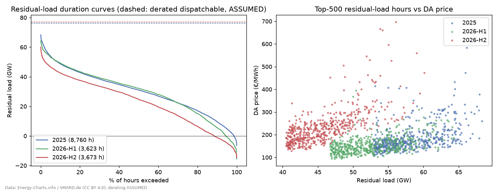
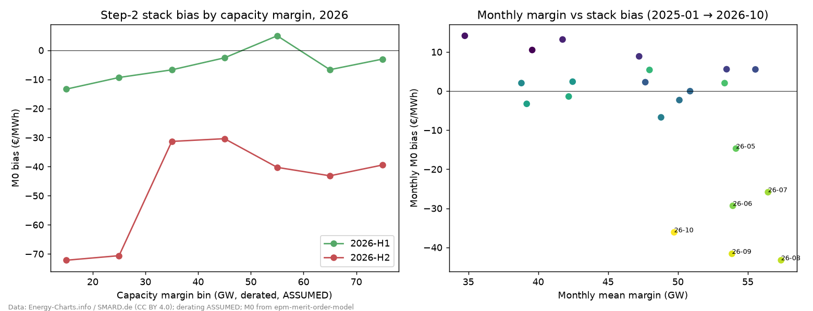
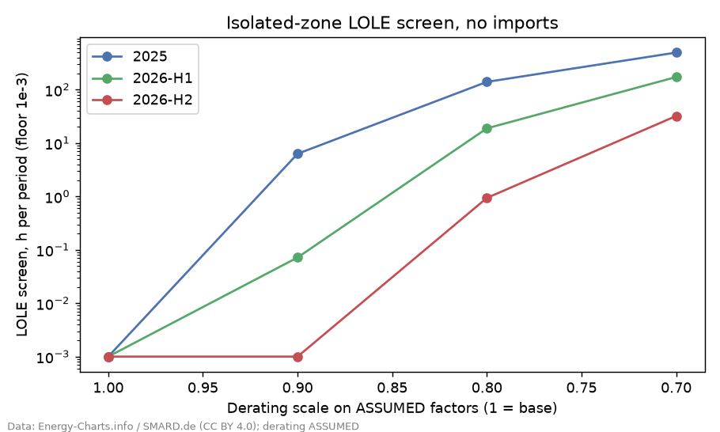

# epm-capacity-adequacy

**Step 4** of the [European Power Market Lab](https://github.com/DataWithSyed/eu-power-market-lab). This step studies **residual load, scarcity hours and dispatchable capacity margins for DE-LU** on the lab panel (2025-01 → 2026-10, 16,056 hours). It then asks whether a tighter system explains the H2-2026 merit-order underpricing found in steps 2–3.



## Problem

Steps 2 and 3 found that the textbook stack underprices Jun–Oct 2026 by about 35 €/MWh, and that carbon explains only 7 % of that gap. A common explanation for prices above the stack is **scarcity**: thin margins, so the last units bid above SRMC. This repo measures how tight the German system actually was:

1. residual-load duration curves (RLDC) and the top-N residual-load hours vs price;
2. hourly dispatchable capacity margin = derated dispatchable capacity − residual load (isolated zone);
3. a LOLE-style screen by Monte Carlo of unit outages, with sensitivities on the derating and on imports;
4. a test of whether the margin explains the step-2 M0 bias.

## Method

- **Data** (reused, not re-fetched): the processed hourly panel and yearly installed capacities shipped by step 2 ([`epm-merit-order-model`](https://github.com/DataWithSyed/epm-merit-order-model), fetch code adapted from step 1 [`epm-data-pipeline`](https://github.com/DataWithSyed/epm-data-pipeline)). They contain hourly means of 15-minute Energy-Charts public net generation, load, residual load and cross-border trade, plus the DE-LU day-ahead price (Bundesnetzagentur | SMARD.de). The step-2 hourly M0 / C3 model prices are shipped in `data/processed/step2_model_prices.csv.gz`. Energy-Charts residual load = load − wind − solar (checked in a test, max deviation < 1 MW).
- **Periods**: `2025` (8,760 h), `2026-H1` = Jan–May (3,623 h), `2026-H2` = Jun–Oct (3,673 h). The split follows steps 2–3, where the underpricing starts in June.
- **Available dispatchable capacity** (`fleet.py`) = Σ installed (Energy-Charts yearly stock) × **ASSUMED** derating. Technologies: lignite, hard coal, gas, oil, other non-renewable, biomass, hydro, pumped storage, battery. The thermal deratings are the same as in step 2. The result is 76.2 GW for 2025 and 77.1 GW for 2026. As a data-derived **lower bound** I also report "demonstrated" capacity, the 99.5 % quantile of observed output per technology. It is censored by demand, because plants only show what the market called.
- **Margin** = available − residual load, ignoring imports (isolated-zone screen).
- **LOLE screen** (`lole.py`): each technology is a set of identical units (ASSUMED sizes). Each unit is available with probability equal to its derating, sampled with 20,000 Monte Carlo draws. The draws are validated against an exact binomial convolution (capacity-outage table) in the tests. For each historical hour, LOLP = P(capacity < residual load − imports). LOLE = Σ LOLP, and EUE = Σ E[max(0, need − capacity)]. Sensitivities: derating × {1.0, 0.9, 0.8, 0.7} and imports {0, 5, 10} GW.
- **Link to H2 underpricing** (`link.py`): step-2 M0 bias by margin bin, and the OLS `DA − M0 = a + c·1[2026-H2] + b·margin_GW + hour FE` on 2026 hours, with a day-block bootstrap (300 draws) for CIs. If tightness explained the gap, `c` would shrink once the margin is controlled for. I also compare seasonally matched Jun–Oct 2025 vs Jun–Oct 2026.

## Key measured results

All numbers come from `python scripts/run_analysis.py` (see `results/summary.json`, `results/period_summary.csv`, `results/lole_screen.csv`, `results/m0_bias_by_margin.csv`, `results/jun_oct_2025_vs_2026.csv`, `results/monthly.csv`).

| Metric | 2025 | 2026-H1 (Jan–May) | 2026-H2 (Jun–Oct) |
|---|---:|---:|---:|
| Residual load mean / p99 / max (GW) | 30.2 / 62.6 / 68.3 | 29.7 / 58.8 / 64.3 | **22.8 / 52.6 / 60.1** |
| DA price mean (€/MWh) | 89.3 | 96.5 | **131.3** |
| DA price in top-100 residual-load hours | 234.5 | 182.3 | **326.9** |
| Overlap of top-100 RL and top-100 price hours | 39 % | 45 % | 67 % |
| Spearman(residual load, price) | 0.91 | 0.84 | 0.88 |
| Derated dispatchable (GW, ASSUMED) | 76.2 | 77.1 | 77.1 |
| Margin mean / p1 / min (GW) | 46.0 / 13.6 / 7.9 | 47.4 / 18.3 / 12.8 | **54.3 / 24.5 / 17.0** |
| Mean net import (GW, + = import) | +2.50 | −0.23 | +0.08 |
| Step-2 M0 bias (€/MWh) | +4.6 | −2.4 | **−35.3** |
| LOLE screen, base derating, no imports (h) | 5·10⁻⁵ | 0 | 0 |
| LOLE screen, derating × 0.8, no imports (h) | 139.7 | 18.8 | 0.94 |
| LOLE screen, derating × 0.8, +10 GW imports (h) | 1.2 | 0.004 | 0 |

Findings:

- **H2-2026 was the loosest period in the sample, not the tightest.** Residual load fell (mean 22.8 GW, max 60.1 GW) and the derated margin widened (mean 54.3 GW, minimum 17.0 GW, vs 7.9 GW in Dec 2025). Prices still reached their highest level. In the 100 highest residual-load hours, H2-2026 prices averaged **326.9 €/MWh**, against 234.5 in 2025, even though those hours had about 12 GW less residual load (mean 52.4 vs 64.2 GW). In those 2025 hours the stack was right (M0 237.7 vs DA 234.5). In H2-2026 it was 82 €/MWh short (244.5 vs 326.9).
- **The capacity margin does not explain the underpricing.** In 2026 the M0 bias is −30 to −43 €/MWh in every H2 margin bin from 30 to 80 GW, against −13 to +5 €/MWh in H1. The H2 gap is **32.8 €/MWh without the margin control and 33.4 €/MWh with it** (95 % CI 29.1–37.9). The margin slope is −0.09 €/MWh per GW (CI −0.25 to +0.05), so the margin explains **−2 %** of the gap. In the 2,434 H2 hours that were *looser* than the H1 median margin (44.9 GW), the bias is still −36.0 €/MWh.
- **The seasonal match tells the same story.** Jun–Oct 2025 had a *tighter* margin than Jun–Oct 2026 (mean 50.6 vs 54.3 GW; 198 vs 167 hours below 30 GW), yet the stack was unbiased then (−0.3 €/MWh) and is −35.3 €/MWh now. Across the 22 months, months with a *higher* mean margin had a *more negative* bias (Spearman −0.58). That runs against the scarcity hypothesis.
- **There is a real scarcity component, but it is small.** H2 hours with a margin ≤ 30 GW (167 h, 4.5 %) show a bias of about −71 €/MWh, twice the H2 average. They contribute only about 3.2 of the 35.3 €/MWh.
- **Adequacy on this screen is comfortable.** With base ASSUMED deratings the isolated-zone LOLE is about 0 h in every period. Loss of load only appears when all deratings are cut by 20 % (2025: 140 h, 435 GWh EUE with no imports), and 10 GW of imports almost removes it (1.2 h). 2025 is the tightest year because of winter peaks (68.3 GW in Dec 2025). Demonstrated (observed-output) capacity is only 47–54 GW, below peak residual load in 169–426 hours per period. Those hours were covered by imports. This lower bound is censored by demand and is not an outage estimate.
- **What changed instead.** Net imports in Jun–Oct fell from +2.6 GW (2025) to +0.08 GW (2026), and Germany was a net exporter in Aug–Oct 2026, while prices rose. That points towards neighbour coupling and fuel / opportunity costs rather than domestic scarcity. Step 2's realised-trade-exogenous variant narrows the Jun–Oct 2026 bias from −35.3 to −27.8 €/MWh, but its MAE gets worse (44.2 vs 37.9) because trade is price-endogenous. This is a lead for steps 5–6, not a result.

| Figure | |
|---|---|
|  |  |
| Step-2 stack bias by margin bin (2026) and monthly margin vs bias | LOLE screen vs derating scale (no imports) |

## How to run

```bash
python -m venv .venv && source .venv/bin/activate
pip install -r requirements.txt
python scripts/run_analysis.py   # ~5 s, writes results/ and figures/
pytest -q
```

## Tests

`pytest -q`: **11 passed**. The tests cover panel sanity, the residual-load identity, period labels, the step-2 join, duration curves, margin and period summaries, deratings capped at nameplate, the demonstrated-capacity quantile, **Monte Carlo vs exact capacity-outage convolution**, LOLE/EUE monotonicity in load and imports, EUE closed form vs brute force, and recovery of a known level shift by the H2-gap regression.

## Assumptions

Every unobserved parameter is labelled **ASSUMED** in [`docs/assumptions.md`](docs/assumptions.md). That covers the deratings, unit sizes, the battery capacity credit, the isolated-zone treatment and the import allowances.

## Limitations

- The deratings are fleet-level **ASSUMED** screening values, not unit availability data. Energy-Charts installed gas (35.3 GW) includes industrial CHP whose output is mostly outside the public net-generation series, so nameplate margins overstate firm market capacity. The derating sweep and the demonstrated-capacity lower bound bracket this.
- The LOLE screen uses the historical residual-load path (no weather resampling), independent unit outages, a time-invariant fleet (no seasonal maintenance) and no ramping or storage energy limits. It is **not** a probabilistic adequacy assessment and must not be compared with official reliability standards.
- Isolated zone: imports enter only as a flat allowance. Batteries get an ASSUMED 20 % capacity credit, because most Energy-Charts battery power is home storage with short duration.
- 22 months of data and 3,673 H2 hours. The H2-gap regression is descriptive (hour FE, day-block bootstrap), not causal.

## Related work

- Umbrella and roadmap: [eu-power-market-lab](https://github.com/DataWithSyed/eu-power-market-lab)
- Step 1 data: [epm-data-pipeline](https://github.com/DataWithSyed/epm-data-pipeline) · Step 2 stack: [epm-merit-order-model](https://github.com/DataWithSyed/epm-merit-order-model) · Step 3 drivers: [epm-co2-gas-price-drivers](https://github.com/DataWithSyed/epm-co2-gas-price-drivers)
- Prior single-repo studies (not duplicated): [clean-spreads-fuel-switching-de](https://github.com/DataWithSyed/clean-spreads-fuel-switching-de), [de-day-ahead-price-forecasting](https://github.com/DataWithSyed/de-day-ahead-price-forecasting)
- Method anchor: Garver, L. L. (1966), "Effective Load Carrying Capability of Generating Units", *IEEE Transactions on Power Apparatus and Systems* PAS-85(8), 910–919, doi:10.1109/TPAS.1966.291652 (verified via Crossref).

Next in the series: **step 5, `epm-price-forecast-benchmark`**.

## Data attribution and licence

Code: MIT. Data: Energy-Charts.info (Fraunhofer ISE), public net generation, load, residual load, cross-border trade and installed power. DE-LU day-ahead prices come from Bundesnetzagentur | SMARD.de. All are **CC BY 4.0**. Only derived hourly panels are shipped; see `data/processed/README.md`.
